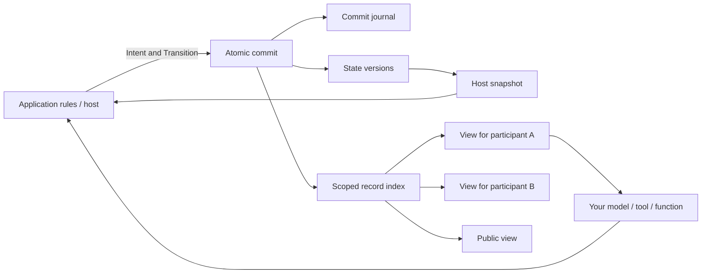

# agent-state-core

**Shared state, individual knowledge, and action outcomes for agent applications.**

[中文说明](README.zh-CN.md) · [Usage guide](docs/GUIDE.md) · [API & architecture](docs/DESIGN.md) · [LangGraph](docs/LANGGRAPH.md) · [Releases](https://github.com/zhaosknss/agent-state-core/releases)

In an agent application, the host may know that a key changed hands while another participant still has an old observation. A message can contain a mistaken claim. A proposed action may fail. A later human decision can make an earlier proposal outdated. These are separate pieces of information worth preserving.

agent-state-core provides small Python primitives for representing those differences and committing their consequences. You choose the data, rules, participants, models, and interaction order. The core uses Python's standard library and SQLite. An optional example actually uses LangGraph for orchestration.

This is an early alpha. I extracted these ideas from a project I was building and would like people to try them in their own applications. Suggestions about use cases, missing features, or awkward interfaces are welcome in [Discussions](https://github.com/zhaosknss/agent-state-core/discussions).

## Complete capability map

| Capability | API / behavior |
|---|---|
| Shared state | JSON values with explicit top-level updates and deletions |
| Individual information | Public, addressed, and host-only `Record` values |
| Claims, observations, provenance | Application-defined kinds and source JSON; records do not implicitly update state |
| Action attempts and outcomes | Optional `Intent` and accepted/rejected `Transition` in host history |
| Persistent consequences | SQLite journal; reopen a file to continue reading and committing |
| Historical reads | `snapshot(at_revision=N)` and `view(..., at_revision=N)` |
| Focused context | View filters for kinds, lower revision bound, and latest matching records |
| Stale-write protection | Explicit base revision; mismatches raise `StaleRevision` |
| Request deduplication | Identical request ID/base/intent/result returns the original commit |
| Host replay lookup | `get_commit(request_id)` before repeating application work |
| Atomic persistence | Journal, state versions, and audience/query tables share one transaction |
| Existing alpha-1 databases | Atomic schema-v1 to schema-v2 upgrade on open |
| External orchestration | Tested optional LangGraph execution, interruption, and resume |

## Where it fits

| Application | A possible use |
|---|---|
| Multi-agent collaboration | Shared decisions alongside each participant's private notes and inputs |
| Role/social simulation | Different observations, reported claims, and continuing consequences |
| Human-assisted workflows | Changed constraints and rejection of results based on an old revision |
| Tool/coding workflows | Attempted actions, host-selected results, and scoped consumers |
| Narrative applications | Established state, character information, and public presentation |

There is no mandatory debate, voting, director, chapter, character sheet, or model provider. A human or ordinary function can participate without an LLM.

## Architecture



`snapshot()` is privileged host data. `view(participant).to_context()` supplies only public or explicitly addressed records. Your application decides what actually changes state and which information is published to each audience.

## Quick start

Requires **Python 3.11+**. The base examples need no API key or runtime dependency:

```bash
git clone https://github.com/zhaosknss/agent-state-core.git
cd agent-state-core
python -m examples.information_flow
python -m examples.collaboration
python -B tools/verify.py
```

`information_flow` demonstrates a private transfer, an old observation, a false claim, a failed action, and reopening a saved file. `collaboration` changes a budget from 100 to 50 and rejects the earlier proposal's stale commit.

To use it in another project, download the wheel from [Releases](https://github.com/zhaosknss/agent-state-core/releases), or install the checkout:

```bash
python -m pip install ./agent_state_core-0.1.0a2-py3-none-any.whl
# Alternatively, from the checkout:
python -m pip install .
```

The project is not published on PyPI.

## A complete small example

```python
from agent_state_core import Intent, Ledger, Record, Transition

with Ledger() as ledger:  # Pass a file path for persistence.
    ledger.commit(
        Transition(
            updates={"key_holder": "alice"},
            records=(Record("observation", {"key_holder": "alice"}, None),),
        ), expected_revision=0,
    )
    ledger.commit(
        Transition(
            updates={"key_holder": "bob"},
            records=(Record("observation", {"key_holder": "bob"}, ("alice", "bob")),),
        ), expected_revision=1,
        intent=Intent("alice", "transfer", {"to": "bob"}),
        request_id="transfer-1",
    )

    assert ledger.snapshot().state["key_holder"] == "bob"
    assert ledger.view("carol").records[-1].body["key_holder"] == "alice"
    assert ledger.snapshot(at_revision=1).state["key_holder"] == "alice"
    print(ledger.view("bob", kinds=("observation",), last=10).to_context())
```

`audience=None` is public, a tuple of IDs is addressed, and `()` is host-only. The application chose that the transfer succeeded; the library stores its result and information scope. Kinds such as `observation` and `claim` are application conventions.

## Real LangGraph integration

```bash
python -m pip install ".[langgraph]"
python -m examples.langgraph_collaboration
python -B tools/verify.py --langgraph
```

This uses **LangGraph 1.2.15** `StateGraph`, `InMemorySaver`, `interrupt`, and `Command`. A graph proposes a plan, pauses for human input, receives a changed budget, and commits the selected plan. Participant input comes from scoped records. A host receipt avoids committing the same review twice on node replay. The example functions are deterministic and make no model requests.

Its graph checkpoints live in memory; production graph persistence needs an appropriate LangGraph checkpointer. See the [integration guide](docs/LANGGRAPH.md) for ownership and retry boundaries.

## Alpha-2 storage improvements

Normal state/view reads use query projections rather than decoding the complete action journal. `view()` supports `kinds`, `after_revision`, and `last`. Schema-v1 databases migrate in one transaction, preserving commits and request fingerprints.

In a synthetic 1001-commit case with one visible record, median combined state/view reads measured **10.338 ms** with the alpha-1 algorithm and **0.094 ms** with indexed reads, with equal outputs. This is one local, private-history-heavy case; it does not establish a general speedup. Reproduce with `python tools/benchmark_reads.py`; see [validation](docs/VALIDATION.md).

## Open-source reuse

| Upstream | Actual use |
|---|---|
| LangGraph, MIT | Optional dependency and tested graph/checkpoint/interrupt APIs |
| Apache Burr, Apache-2.0 | Fixed-version SQLite persistence reviewed for targeted reads; design reference, no copied code |
| Graphiti, Generative Agents, Concordia | Related designs; not dependencies or validated adapters |

Fixed revisions, inspected files, licenses, and dependencies are in [upstream review](docs/UPSTREAM.md) and [provenance](PROVENANCE.md).

## Scope and limits

The library records host decisions. It does not infer truth from text, update beliefs automatically, judge prose consistency, or choose a conversation policy. Revision checks are global and conservative. Filtering is host-side context selection, not authentication or untrusted-code isolation. Model/tool effects are outside the SQLite transaction; commit deduplication does not make external calls exactly-once.

The LangGraph example verifies one integration path. Complete compatibility with other frameworks, real model quality, arbitrary speculative branches, and large-scale production workloads remain unvalidated.

## Documentation and feedback

- [Usage guide](docs/GUIDE.md) / [中文指南](docs/GUIDE.zh-CN.md): state, records, queries, actions, and retries.
- [API & architecture](docs/DESIGN.md): semantics and schema.
- [LangGraph](docs/LANGGRAPH.md): optional setup and pause/resume.
- [Operations](docs/OPERATIONS.md): migration, backups, checks, and troubleshooting.
- [Validation](docs/VALIDATION.md), [upstream review](docs/UPSTREAM.md), [changelog](CHANGELOG.md).

I would like to hear what you would use this for, which parts fit, and where the API gets in your way. Start a [discussion](https://github.com/zhaosknss/agent-state-core/discussions), report a reproducible [issue](https://github.com/zhaosknss/agent-state-core/issues), or send a focused change. See [contributing](CONTRIBUTING.md).

## License

[MIT](LICENSE). The core has no third-party runtime dependencies; optional integrations have their own dependency and license information.
