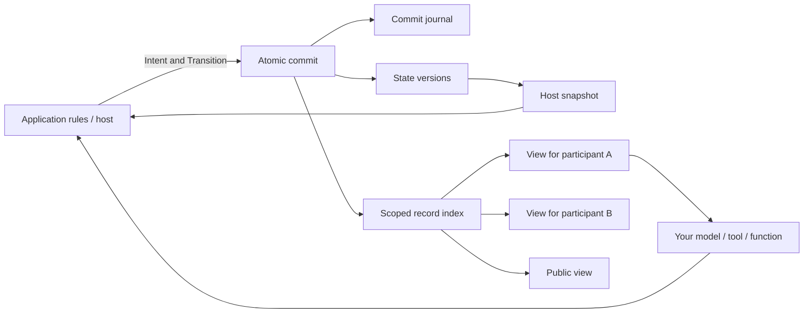

# Agent State Core

**One core. Different agent applications.**

Record **what happened, who can see it, and the outcome of each action**.
agent-state-core is a small Python + SQLite library for shared state, scoped
information, sources, and history. Use it on its own or combine it with your
choice of models, tools, memory systems, and orchestrators through application
adapters. Your application chooses the participants, JSON content, business
rules, and execution order.

**Python 3.11+ · SQLite · MIT · Early alpha** — no third-party core runtime dependencies.

[中文说明](README.zh-CN.md) · [Try the examples](#quick-start) · [Ways to combine](#ways-to-combine) · [Current capabilities](#current-capabilities) · [Ideas to explore](#directions-to-explore) · [API & architecture](docs/DESIGN.md)

## Ways to combine

Choose the surrounding components to suit your application. These are composition
ideas; your application supplies the extra components and connects their APIs.

| Add the core to… | A possible application |
|---|---|
| A planner, models, and tools | Multi-agent collaboration, tool workflows, and human-reviewed tasks |
| Character, memory, and generation components | Role interaction, social simulation, and narrative applications |
| Conversation processing, retrieval, and documentation tools | Context handoff, project continuation, and reusable understanding |

The [composition guide](docs/COMPOSITION.md) includes tested LangGraph orchestration
and a LangChain Core storage/retrieval recipe, with reproduced integration limits.
The runnable examples below show what the core provides today. A human or ordinary
function can participate; data kinds and conversation policies stay with the application.

## Quick start

Requires **Python 3.11+**. Run from a current source checkout; the base examples
use ordinary functions and need no API key or third-party runtime dependency:

```bash
git clone https://github.com/zhaosknss/agent-state-core.git
cd agent-state-core
python -m examples.context_handoff
python -m examples.information_flow
python -m examples.collaboration
python -B tools/verify.py
```

| Example | What you can inspect |
|---|---|
| [Context handoff](docs/CONTEXT_HANDOFF.md) | Candidates with sources and scope; later revision, withdrawal, and incremental reads |
| [Information flow](examples/information_flow.py) | A private transfer, an old observation, a false claim, a failed action, and reopening a saved file |
| [Collaboration](examples/collaboration.py) | A budget changes from 100 to 50; a proposal based on the old revision cannot overwrite the new state |

The handoff and retrieval recipes are Unreleased source additions, absent from the existing
alpha-2 archives. To use the core in another project, download the wheel from
[Releases](https://github.com/zhaosknss/agent-state-core/releases), or install the checkout:

```bash
python -m pip install ./agent_state_core-0.1.0a2-py3-none-any.whl
# Alternatively, from the checkout:
python -m pip install .
```

The project is not published on PyPI. Try a small example, adapt it to your use
case, and share questions or suggestions in [Discussions](https://github.com/zhaosknss/agent-state-core/discussions).

## Current capabilities

| Capability | API / behavior |
|---|---|
| Shared state | JSON values with explicit top-level updates and deletions |
| Individual information | Public, addressed, and host-only `Record` values |
| Claims, observations, provenance | Application-defined kinds and source JSON; records do not implicitly update state |
| Action attempts and outcomes | Optional `Intent` and accepted/rejected `Transition` in host history |
| Persistent consequences | SQLite journal; reopen a file to continue reading and committing |
| Historical reads | `snapshot(at_revision=N)` and `view(..., at_revision=N)` |
| Focused context | View filters for kinds, lower revision bound, and latest matching records |
| Stale-write protection | Explicit base revision; mismatches raise `StaleRevision` |
| Request deduplication | Identical request ID/base/intent/result returns the original commit |
| Host replay lookup | `get_commit(request_id)` before repeating application work |
| Atomic persistence | Journal, state versions, and audience/query tables share one transaction |
| Existing alpha-1 databases | Atomic schema-v1 to schema-v2 upgrade on open |
| External orchestration | Tested optional synchronous LangGraph execution, interruption, and resume |
| Derived retrieval | Optional LangChain Core recipe built from a scoped View; cache rebuild stays application policy |

## Architecture

The host may know that a key changed hands while another participant still has
an old observation. A message can contain a mistaken claim, a proposed action
can fail, and later human input can make an earlier proposal outdated. The core
keeps these records separate; your application decides what becomes state.



`snapshot()` is privileged host data. `view(participant).to_context()` supplies only public or explicitly addressed records. Your application decides what actually changes state and which information is published to each audience.

## A complete small example

```python
from agent_state_core import Intent, Ledger, Record, Transition

with Ledger() as ledger:  # Pass a file path for persistence.
    ledger.commit(
        Transition(
            updates={"key_holder": "alice"},
            records=(Record("observation", {"key_holder": "alice"}, None),),
        ), expected_revision=0,
    )
    ledger.commit(
        Transition(
            updates={"key_holder": "bob"},
            records=(Record("observation", {"key_holder": "bob"}, ("alice", "bob")),),
        ), expected_revision=1,
        intent=Intent("alice", "transfer", {"to": "bob"}),
        request_id="transfer-1",
    )

    assert ledger.snapshot().state["key_holder"] == "bob"
    assert ledger.view("carol").records[-1].body["key_holder"] == "alice"
    assert ledger.snapshot(at_revision=1).state["key_holder"] == "alice"
    print(ledger.view("bob", kinds=("observation",), last=10).to_context())
```

`audience=None` is public, a tuple of IDs is addressed, and `()` is host-only. The application chose that the transfer succeeded; the library stores its result and information scope. Kinds such as `observation` and `claim` are application conventions.

## Context handoff and revised understanding

The current checkout includes a [handoff recipe](docs/CONTEXT_HANDOFF.md) for sharing candidate interpretations with their project, scope, and source. Later feedback can revise or withdraw a note; a new conversation receives the latest visible changes while the full history remains available. A delivery accepted for today can stay distinct from an ideal template for future work.

Run `python -m examples.context_handoff`. It uses fictional messages, ordinary functions, and existing APIs. The helpers and latest-visible-key policy live in the example, not the installed core package. Automatic extraction, chat access, and coordination remain application work; the example does not establish model quality or fewer user corrections. This is an Unreleased source addition, not part of the existing alpha-2 artifacts.

## Real LangGraph integration

```bash
python -m pip install ".[langgraph]"
python -m examples.langgraph_collaboration
python -B tools/verify.py --langgraph
```

This uses **LangGraph 1.2.15** `StateGraph`, `InMemorySaver`, `interrupt`, and `Command`. A graph proposes a plan, pauses for human input, receives a changed budget, and commits the selected plan. Participant input comes from scoped records. A host receipt avoids committing the same review twice on node replay. The example functions are deterministic and make no model requests.

Its graph checkpoints live in memory; production graph persistence needs an appropriate LangGraph checkpointer. This recipe uses synchronous `invoke`; calling it with `ainvoke` encounters connection thread ownership. See the [integration guide](docs/LANGGRAPH.md) for ownership and retry boundaries.

## Compose with storage and retrieval

```bash
python -m pip install -r requirements/retrieval-test.txt
python -m examples.langchain_retrieval
python -B tools/verify.py --retrieval
```

This separate recipe uses real **LangChain Core 1.6.11** `InMemoryStore` and
`RunnableLambda` APIs. It caches only records from a scoped View, retains IDs and
sources, and rebuilds after new commits. Lookup is ordinary keyword matching;
no model, embeddings, or vector store is involved. LangGraph is not required.
See [composition and its limits](docs/COMPOSITION.md) for cache ownership,
global revision conflicts, thread constraints, and why `last` is not pagination.

## Alpha-2 storage improvements

Normal state/view reads use query projections rather than decoding the complete action journal. `view()` supports `kinds`, `after_revision`, and `last`. Schema-v1 databases migrate in one transaction, preserving commits and request fingerprints.

In a synthetic 1001-commit case with one visible record, median combined state/view reads measured **10.338 ms** with the alpha-1 algorithm and **0.094 ms** with indexed reads, with equal outputs. This is one local, private-history-heavy case; it does not establish a general speedup. Reproduce with `python tools/benchmark_reads.py`; see [validation](docs/VALIDATION.md).

## Open-source reuse

| Upstream | Actual use |
|---|---|
| LangGraph, MIT | Optional dependency and tested graph/checkpoint/interrupt APIs |
| LangChain Core, MIT | Optional recipe using real in-memory storage and Runnable APIs; no copied source |
| Apache Burr, Apache-2.0 | Fixed-version SQLite persistence reviewed for targeted reads; design reference, no copied code |
| Graphiti, Generative Agents, Concordia | Related designs; not dependencies or validated adapters |

Fixed revisions, inspected files, licenses, and dependencies are in [upstream review](docs/UPSTREAM.md) and [provenance](PROVENANCE.md).

## Scope and limits

The library records host decisions. It does not infer truth from text, update beliefs automatically, judge prose consistency, or choose a conversation policy. Revision checks are global and conservative. Filtering is host-side context selection, not authentication or untrusted-code isolation. Model/tool effects are outside the SQLite transaction; commit deduplication does not make external calls exactly-once.

The optional examples verify specific paths within the LangChain ecosystem. Complete compatibility with other frameworks, real model quality, arbitrary speculative branches, and large-scale production workloads remain unvalidated. The [composition audit](docs/COMPOSITION.md) reproduces concrete constraints before proposing further core changes.

## Directions to explore

The same primitives could support several kinds of applications. These ideas
are invitations to discuss or build with the core, rather than delivered features
or a fixed product roadmap:

- **Independent conversations that compare understanding.** Retain each
  participant's relevant experience, exchange evidence, surface disagreements,
  and revise interpretations. A coordinator's reading can be challenged too.
- **Reviews and collaborative work that accumulate results.** Compare different
  perspectives, distinguish new findings from duplicates or mistakes, and carry
  validated outcomes into subsequent tasks.
- **Experience that travels between projects.** Let projects keep their own goals
  while considering one another's findings. Each application chooses what to
  reuse and records its own resulting decisions.
- **Continuity across tools and sessions.** Explore documentation cleanup,
  feedback-informed handoffs, and an optional Codex plugin as a user-facing entry.

The current library stores records supplied by your application. Conversation
access, automatic extraction, semantic conflict resolution, and coordination
need application logic or external components. The examples do not establish
better reasoning, fewer user corrections, or lower model costs. Which combinations
would help your project, and where would the current API get in the way?

## Documentation and feedback

- [Usage guide](docs/GUIDE.md) / [中文指南](docs/GUIDE.zh-CN.md): state, records, queries, actions, and retries.
- [API & architecture](docs/DESIGN.md): semantics and schema.
- [Composition guide](docs/COMPOSITION.md) / [中文](docs/COMPOSITION.zh-CN.md): runnable retrieval recipe, adapters, and reproduced boundaries.
- [LangGraph](docs/LANGGRAPH.md): optional setup and pause/resume.
- [Operations](docs/OPERATIONS.md): migration, backups, checks, and troubleshooting.
- [Validation](docs/VALIDATION.md), [upstream review](docs/UPSTREAM.md), [changelog](CHANGELOG.md).

I would like to hear what you would use this for, which parts fit, and where the API gets in your way. Start a [discussion](https://github.com/zhaosknss/agent-state-core/discussions), report a reproducible [issue](https://github.com/zhaosknss/agent-state-core/issues), or send a focused change. See [contributing](CONTRIBUTING.md).

## License

[MIT](LICENSE). The core has no third-party runtime dependencies; optional integrations have their own dependency and license information.
