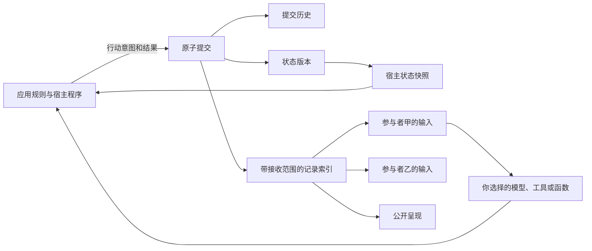

# Agent State Core

**同一套通用底层，组合出不同的智能体应用。**

记录**发生了什么、谁能看到什么，以及行动带来了什么结果**。
agent-state-core 是一个轻量的 Python＋SQLite 库，保存共享状态、带可见范围的记录、来源与历史。
可以单独使用，也可以通过应用层适配，与你选择的模型、工具、记忆和编排组件组合。
参与者、JSON 内容、业务规则与执行顺序由你的应用决定。

**Python 3.11+ · SQLite · MIT · Early alpha** — 核心无第三方运行依赖。

[English](README.md) · [先运行示例](#快速试用) · [看看怎样组合](#如何组合) · [当前能力](#当前能力) · [用途探索](#正在探索的用途) · [接口与架构](docs/DESIGN.md)

## 如何组合

按自己的应用选择外围组件。下表是组合思路，额外组件及其接口接线由应用提供。

| 把这个底层与什么组合 | 可以形成哪类应用 |
|---|---|
| 任务编排、模型和工具 | 多 AI 协作、工具工作流、人参与复核的任务 |
| 角色、记忆和生成组件 | 角色互动、社会模拟与叙事应用 |
| 对话处理、检索和文档整理工具 | 上下文交接、项目接续与理解复用 |

[组合指南](docs/COMPOSITION.zh-CN.md)提供已测试的 LangGraph 编排、LangChain Core 存储检索路径，以及实际复现的接入限制；下方示例可以直接查看当前底层的行为。
参与者也可以是人或普通函数，记录种类和对话策略由接入方选择。

## 快速试用

需要 **Python 3.11 以上**。从当前源码目录运行，基础示例使用普通函数，不需要 API key 或第三方运行依赖：

```powershell
git clone https://github.com/zhaosknss/agent-state-core.git
cd agent-state-core
python -m examples.context_handoff
python -m examples.information_flow
python -m examples.collaboration
python -B tools/verify.py
```

| 示例 | 可以直接看到什么 |
|---|---|
| [上下文交接](docs/CONTEXT_HANDOFF.zh-CN.md) | 带来源与范围的候选理解，后续修订、撤回及增量读取 |
| [信息流](examples/information_flow.py) | 私下交接、旧观察、错误说法、失败行动，以及重新打开存档 |
| [协作与条件变化](examples/collaboration.py) | 预算由 100 变为 50，基于旧版本的方案无法覆盖新状态 |

交接和检索示例属于 Unreleased 源码更新，现有 alpha 2 发布包不包含它们。
在自己的项目里使用核心，可以下载 [Releases](https://github.com/zhaosknss/agent-state-core/releases) 中的 wheel，或安装源码目录：

```powershell
python -m pip install ./agent_state_core-0.1.0a2-py3-none-any.whl
# 或者在源码目录执行：
python -m pip install .
```

目前没有发布到 PyPI。欢迎先试一个小例子，按自己的用途调整，再到 [Discussions](https://github.com/zhaosknss/agent-state-core/discussions) 提问题、建议或不同的设计想法。

## 当前能力

| 能力 | 具体做什么 |
|---|---|
| 共享状态 | 保存任意 JSON 值，明确更新或删除顶层字段 |
| 不同的信息范围 | 一条记录可以公开、发给指定参与者，或只供宿主保留 |
| 观察、说法与来源 | 保留内容种类和来源 JSON；收到说法不会自动改写状态 |
| 行动与后果 | 分别记录行动意图、接受或拒绝的结果、状态变化及对外信息 |
| 持续保存 | SQLite 文件保存历史；关闭后重新打开可以继续读取和提交 |
| 历史回看 | 按版本读取当时的状态和可见记录，排除之后发生的内容 |
| 按需取上下文 | 按记录种类、版本范围和最近匹配条数筛选 |
| 防止过期覆盖 | 提交时核对基础版本，不匹配就返回 `StaleRevision` |
| 本地提交去重 | 同一请求、基础版本、意图和结果完全一致时，取回原提交 |
| 查询既有结果 | 宿主先按请求 ID 查已提交结果，再决定是否重做节点工作 |
| 一致落盘 | 日志、状态版本和查询表在同一个事务中提交或回滚 |
| 旧库升级 | 原子升级首版数据库到 v2 查询结构，保留旧记录和请求指纹 |
| 外部编排 | 可选 LangGraph 示例接通同步编排、中断、恢复与节点重跑 |
| 派生检索 | 可选 LangChain Core 示例只缓存可见 View；缓存重建由应用决定 |

## 底层怎样工作

系统可能知道钥匙已交给乙，丙却还只知道它原来在甲手里；转述可能出错，提出的行动可能失败，人后来改变条件也可能让旧方案过时。
底层分别保存这些记录，由应用判断哪些结果更新状态。



宿主用 `snapshot()` 读取全局状态、判断规则并提交结果。参与者用 `view(id).to_context()` 接收公开或明确发给自己的记录。哪些变化成立、哪些信息向谁提供，由应用决定。

## 一个完整的小例子

```python
from agent_state_core import Intent, Ledger, Record, Transition

with Ledger() as ledger:  # 换成文件路径即可持续保存。
    ledger.commit(
        Transition(
            updates={"key_holder": "alice"},
            records=(Record("observation", {"key_holder": "alice"}, None),),
        ), expected_revision=0,
    )
    ledger.commit(
        Transition(
            updates={"key_holder": "bob"},
            records=(Record("observation", {"key_holder": "bob"}, ("alice", "bob")),),
        ), expected_revision=1,
        intent=Intent("alice", "transfer", {"to": "bob"}),
        request_id="transfer-1",
    )

    assert ledger.snapshot().state["key_holder"] == "bob"
    assert ledger.view("carol").records[-1].body["key_holder"] == "alice"
    assert ledger.snapshot(at_revision=1).state["key_holder"] == "alice"
    print(ledger.view("bob", kinds=("observation",), last=10).to_context())
```

`audience=None` 表示公开，`("alice", "bob")` 表示指定接收者，`()` 表示只给宿主保留。应用已经判定交接成功，库负责保存结果和信息范围。`observation`、`claim` 等记录种类由应用自定。

## 上下文交接与理解修订

当前源码新增[可运行的交接示例](docs/CONTEXT_HANDOFF.zh-CN.md)：理解作为候选记录，保留适用项目、范围和来源；后来反馈可以修订或撤回。新对话取得最后可见的变化，完整历史仍可回看，也能区分“本次采用”与“以后作为理想模板”。

运行 `python -m examples.context_handoff` 即可。示例使用虚构消息、普通函数和现有接口，辅助函数与组织策略位于示例中，没有写成核心的强制规则。自动提取、读取聊天和安排讨论仍需上层接入，示例不证明模型效果或反馈次数改善。这是 Unreleased 源码更新，现有 alpha 2 发布包不包含新示例。

## 实际接入 LangGraph

```powershell
python -m pip install ".[langgraph]"
python -m examples.langgraph_collaboration
python -B tools/verify.py --langgraph
```

示例实际使用 **LangGraph 1.2.15** 的 `StateGraph`、`InMemorySaver`、`interrupt` 和 `Command`：先提出方案，在人工复核处暂停，再按人输入的新预算继续并提交。参与者函数取得筛选后的记录；节点重跑时可以查询宿主已提交结果，避免再次提交同一决定。

示例中的参与者是普通函数，没有发模型请求。图检查点使用内存保存，只演示进程内暂停恢复；生产环境需要合适的持久化 checkpointer。当前示例使用同步 `invoke`，直接改用 `ainvoke` 会遇到连接的线程归属限制。存储分工和重试方式见 [接入指南](docs/LANGGRAPH.md)。

## 与存储和检索组件组合

```powershell
python -m pip install -r requirements/retrieval-test.txt
python -m examples.langchain_retrieval
python -B tools/verify.py --retrieval
```

另一个示例实际调用 **LangChain Core 1.6.11** 的 `InMemoryStore` 和 `RunnableLambda`：
只缓存可见 View 中的记录，保留 ID 和来源，新提交后重建缓存。
查找使用普通关键词匹配，不调用模型、嵌入或向量库，也不要求安装 LangGraph。
缓存分工、全局版本冲突、线程约束，以及“最近几条”为何不能当分页，见[组合指南](docs/COMPOSITION.zh-CN.md)。

## 这一版的实际优化

alpha 2 改为按接收范围查询记录、按字段版本读取状态，避免每次解析全部行动历史。`view()` 新增种类、版本下界和最近匹配条数筛选。旧库在一个事务里升级查询结构。

本地合成案例中，1001 次提交只有 1 条对目标参与者可见的记录，组合读取状态与信息的中位耗时由旧算法的 **10.338 毫秒**变为 **0.094 毫秒**，输出一致。这是私有历史较多的特定案例，不能推广为所有场景的提速比例。可运行 `python tools/benchmark_reads.py` 复现，见 [验证记录](docs/VALIDATION.md)。

## 使用了哪些开源项目

| 项目 | 实际使用方式 |
|---|---|
| LangGraph，MIT | 可选依赖，实际调用编排、检查点、中断、恢复接口并测试 |
| LangChain Core，MIT | 可选示例实际调用内存存储和 Runnable 管线；未复制源码 |
| Apache Burr，Apache-2.0 | 核对固定版本 SQLite 持久化代码，参考按条件查询的方式；未复制源码 |
| Graphiti、Generative Agents、Concordia | 设计对照，本版没有接入其运行库，也未据此宣称兼容 |

对应版本、文件、许可证、实际依赖和设计参考分别记录在 [上游核查](docs/UPSTREAM.md) 与 [来源说明](PROVENANCE.md)。核心安装仍不需要第三方运行依赖；外部组件只在使用对应可选示例时安装。

## 当前边界

本库保存宿主判定的结果，没有实现自动核实自然语言、自动更新人物信念、评判文笔或安排讨论流程。版本检查是全局检查，比较保守。记录筛选用于宿主组织上下文，不能代替身份认证或不可信代码隔离。

远端模型和工具调用发生在 SQLite 事务外，本地提交去重不能保证它们只执行一次。真实模型质量、任意预演分支、大规模生产负载及其他框架的完整适配仍未验证。

两个可选示例验证了 LangChain 生态内的具体路径；底层组合核验还复现了全局版本、读取窗口与线程连接方面的限制，见[组合指南](docs/COMPOSITION.zh-CN.md)。

## 正在探索的用途

相同的基础机制可以用于不同应用。以下是希望与大家讨论、尝试的方向，尚未作为完整功能交付，也不是固定开发清单：

- **独立对话共同理解与纠偏。** 保留各自相关经历，交换依据，指出分歧并修正理解；协调者的概括也可以被其他对话质疑。
- **能积累结果的审查与协作。** 对照不同视角，区分新增发现、重复和误判，把核验后的结果带入后续任务。
- **不同项目互相吸收经验。** 各自保持目标，参考其他方向的发现，由各应用选择采纳什么，并保留自己的决定与后果。
- **跨工具和会话的接续。** 探索文档整理、结合既有反馈的交接，以及作为使用入口的 Codex 插件。

当前库保存的是应用提供的记录；读取聊天、自动提取、语义冲突处理和讨论协调仍需上层逻辑或外部组件。
现有示例不证明模型推理更好、反馈次数更少或调用成本更低。你希望把哪些组件组合起来？当前接口还缺什么？

## 进一步使用与反馈

- [完整中文指南](docs/GUIDE.zh-CN.md)：状态、信息、行动、查询与重试。
- [接口与架构](docs/DESIGN.md)：精确语义和数据库结构。
- [组合指南](docs/COMPOSITION.zh-CN.md)：可运行的检索组合、适配分工和已复现限制。
- [LangGraph 接入](docs/LANGGRAPH.md)：安装、暂停恢复与存储分工。
- [运行与排错](docs/OPERATIONS.md)：升级、备份、验证和常见错误。
- [验证记录](docs/VALIDATION.md)、[上游核查](docs/UPSTREAM.md)、[版本变化](CHANGELOG.md)。

你会想用在哪种项目里？哪些部分有用，哪些接口不好理解或不顺手？想法可以发到 [Discussions](https://github.com/zhaosknss/agent-state-core/discussions)；发现 bug 时，在 [Issues](https://github.com/zhaosknss/agent-state-core/issues) 留下能复现的小例子、预期和实际结果就很有帮助。欢迎直接改代码，见 [参与说明](CONTRIBUTING.md)。

## 许可

[MIT](LICENSE)。可选集成的依赖与许可证单独记录在上游核查中。
