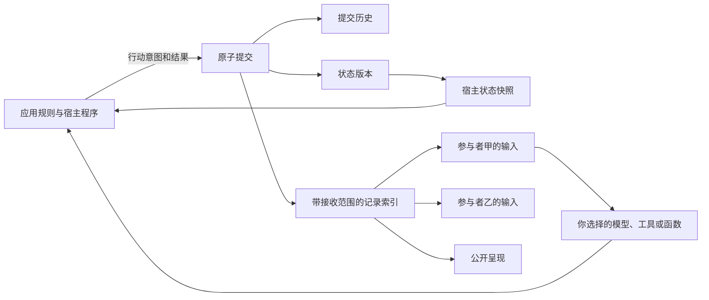

# agent-state-core

**为智能体应用提供共享状态、各自认知记录和行动后果的基础能力。**

[English](README.md) · [完整使用指南](docs/GUIDE.zh-CN.md) · [接口与架构](docs/DESIGN.md) · [LangGraph 接入](docs/LANGGRAPH.md) · [下载版本](https://github.com/zhaosknss/agent-state-core/releases)

多智能体应用里，同一件事可能有几种不同的记录：系统知道钥匙已经交给乙，丙还只知道它原来在甲手里；有人转述了错误说法；一个行动被提出，但没有成功；人后来改了条件，之前的方案需要重新判断。

这个库分别保存这些内容，让已经发生的结果持续影响后续。数据、动作、规则、参与者、模型和调用顺序由接入应用决定。核心使用 Python 标准库与 SQLite，另有实际运行的 LangGraph 可选接入示例。

这是早期 alpha。我从自己的项目中拆出这些基础机制，希望大家放到实际项目里试试，也欢迎提问题、建议或不同的设计想法。

## 已有完整功能

| 能力 | 具体做什么 |
|---|---|
| 共享状态 | 保存任意 JSON 值，明确更新或删除顶层字段 |
| 不同的信息范围 | 一条记录可以公开、发给指定参与者，或只供宿主保留 |
| 观察、说法与来源 | 保留内容种类和来源 JSON；收到说法不会自动改写状态 |
| 行动与后果 | 分别记录行动意图、接受或拒绝的结果、状态变化及对外信息 |
| 持续保存 | SQLite 文件保存历史；关闭后重新打开可以继续读取和提交 |
| 历史回看 | 按版本读取当时的状态和可见记录，排除之后发生的内容 |
| 按需取上下文 | 按记录种类、版本范围和最近匹配条数筛选 |
| 防止过期覆盖 | 提交时核对基础版本，不匹配就返回 `StaleRevision` |
| 本地提交去重 | 同一请求、基础版本、意图和结果完全一致时，取回原提交 |
| 查询既有结果 | 宿主先按请求 ID 查已提交结果，再决定是否重做节点工作 |
| 一致落盘 | 日志、状态版本和查询表在同一个事务中提交或回滚 |
| 旧库升级 | 原子升级首版数据库到 v2 查询结构，保留旧记录和请求指纹 |
| 外部编排 | 可选 LangGraph 示例接通编排、中断、恢复与节点重跑 |

## 可以用在哪

| 用途 | 可组合的机制 |
|---|---|
| 多 AI 协作 | 共享已采用决定，各自保留不同输入和私有记录 |
| 角色与社会模拟 | 不同观察、误传、行动后果，以及之后的状态变化 |
| 人参与的流程 | 修改条件后继续处理，阻止旧版本结果覆盖新状态 |
| 工具或代码智能体 | 记录尝试、执行结果，向不同消费者提供所需信息 |
| 叙事应用 | 分别组织已成立状态、人物掌握的信息和公开呈现 |

这些是用途示例，可以只取其中一部分，也可以自行组合。没有固定的讨论轮数、投票流程、导演、人物或章节结构。

## 底层怎样工作



宿主用 `snapshot()` 读取全局状态、判断规则并提交结果。参与者用 `view(id).to_context()` 接收公开或明确发给自己的记录。哪些变化成立、哪些信息向谁提供，由应用决定。

## 快速试用

需要 **Python 3.11 以上**。基础示例不需要 API key，也不用安装第三方运行依赖：

```powershell
git clone https://github.com/zhaosknss/agent-state-core.git
cd agent-state-core
python -m examples.information_flow
python -m examples.collaboration
python -m examples.context_handoff
python -B tools/verify.py
```

第一个例子展示私下交接、旧观察、错误说法、失败行动及重新打开存档。第二个把预算从 100 改为 50，拒绝基于旧版本的方案提交。

在自己的 Python 项目里使用，可以下载 [Releases](https://github.com/zhaosknss/agent-state-core/releases) 中的 wheel，或安装源码目录：

```powershell
python -m pip install ./agent_state_core-0.1.0a2-py3-none-any.whl
# 或者在源码目录执行：
python -m pip install .
```

目前没有发布到 PyPI。

## 一个完整的小例子

```python
from agent_state_core import Intent, Ledger, Record, Transition

with Ledger() as ledger:  # 换成文件路径即可持续保存。
    ledger.commit(
        Transition(
            updates={"key_holder": "alice"},
            records=(Record("observation", {"key_holder": "alice"}, None),),
        ), expected_revision=0,
    )
    ledger.commit(
        Transition(
            updates={"key_holder": "bob"},
            records=(Record("observation", {"key_holder": "bob"}, ("alice", "bob")),),
        ), expected_revision=1,
        intent=Intent("alice", "transfer", {"to": "bob"}),
        request_id="transfer-1",
    )

    assert ledger.snapshot().state["key_holder"] == "bob"
    assert ledger.view("carol").records[-1].body["key_holder"] == "alice"
    assert ledger.snapshot(at_revision=1).state["key_holder"] == "alice"
    print(ledger.view("bob", kinds=("observation",), last=10).to_context())
```

`audience=None` 表示公开，`("alice", "bob")` 表示指定接收者，`()` 表示只给宿主保留。应用已经判定交接成功，库负责保存结果和信息范围。`observation`、`claim` 等记录种类由应用自定。

## 上下文交接与理解修订

当前源码新增[可运行的交接示例](docs/CONTEXT_HANDOFF.zh-CN.md)：理解作为候选记录，保留适用项目、范围和来源；后来反馈可以修订或撤回。新对话取得最后可见的变化，完整历史仍可回看，也能区分“本次采用”与“以后作为理想模板”。

运行 `python -m examples.context_handoff` 即可。示例使用虚构消息、普通函数和现有接口，辅助函数与组织策略位于示例中，没有写成核心的强制规则。自动提取、读取聊天和安排讨论仍需上层接入，示例不证明模型效果或反馈次数改善。这是 Unreleased 源码更新，现有 alpha 2 发布包不包含新示例。

## 实际接入 LangGraph

```powershell
python -m pip install ".[langgraph]"
python -m examples.langgraph_collaboration
python -B tools/verify.py --langgraph
```

示例实际使用 **LangGraph 1.2.15** 的 `StateGraph`、`InMemorySaver`、`interrupt` 和 `Command`：先提出方案，在人工复核处暂停，再按人输入的新预算继续并提交。参与者函数取得筛选后的记录；节点重跑时可以查询宿主已提交结果，避免再次提交同一决定。

示例中的参与者是普通函数，没有发模型请求。图检查点使用内存保存，只演示进程内暂停恢复；生产环境需要合适的持久化 checkpointer。存储分工和重试方式见 [接入指南](docs/LANGGRAPH.md)。

## 这一版的实际优化

alpha 2 改为按接收范围查询记录、按字段版本读取状态，避免每次解析全部行动历史。`view()` 新增种类、版本下界和最近匹配条数筛选。旧库在一个事务里升级查询结构。

本地合成案例中，1001 次提交只有 1 条对目标参与者可见的记录，组合读取状态与信息的中位耗时由旧算法的 **10.338 毫秒**变为 **0.094 毫秒**，输出一致。这是私有历史较多的特定案例，不能推广为所有场景的提速比例。可运行 `python tools/benchmark_reads.py` 复现，见 [验证记录](docs/VALIDATION.md)。

## 使用了哪些开源项目

| 项目 | 实际使用方式 |
|---|---|
| LangGraph，MIT | 可选依赖，实际调用编排、检查点、中断、恢复接口并测试 |
| Apache Burr，Apache-2.0 | 核对固定版本 SQLite 持久化代码，参考按条件查询的方式；未复制源码 |
| Graphiti、Generative Agents、Concordia | 设计对照，本版没有接入其运行库，也未据此宣称兼容 |

对应版本、文件、许可证、实际依赖和设计参考分别记录在 [上游核查](docs/UPSTREAM.md) 与 [来源说明](PROVENANCE.md)。核心安装仍不需要第三方运行依赖；LangGraph 及其依赖只随可选接入安装。

## 当前边界

本库保存宿主判定的结果，没有实现自动核实自然语言、自动更新人物信念、评判文笔或安排讨论流程。版本检查是全局检查，比较保守。记录筛选用于宿主组织上下文，不能代替身份认证或不可信代码隔离。

远端模型和工具调用发生在 SQLite 事务外，本地提交去重不能保证它们只执行一次。真实模型质量、任意预演分支、大规模生产负载及其他框架的完整适配仍未验证。

## 进一步使用与反馈

- [完整中文指南](docs/GUIDE.zh-CN.md)：状态、信息、行动、查询与重试。
- [接口与架构](docs/DESIGN.md)：精确语义和数据库结构。
- [LangGraph 接入](docs/LANGGRAPH.md)：安装、暂停恢复与存储分工。
- [运行与排错](docs/OPERATIONS.md)：升级、备份、验证和常见错误。
- [验证记录](docs/VALIDATION.md)、[上游核查](docs/UPSTREAM.md)、[版本变化](CHANGELOG.md)。

你会想用在哪种项目里？哪些部分有用，哪些接口不好理解或不顺手？想法可以发到 [Discussions](https://github.com/zhaosknss/agent-state-core/discussions)；发现 bug 时，在 [Issues](https://github.com/zhaosknss/agent-state-core/issues) 留下能复现的小例子、预期和实际结果就很有帮助。欢迎直接改代码，见 [参与说明](CONTRIBUTING.md)。

## 许可

[MIT](LICENSE)。可选集成的依赖与许可证单独记录在上游核查中。
